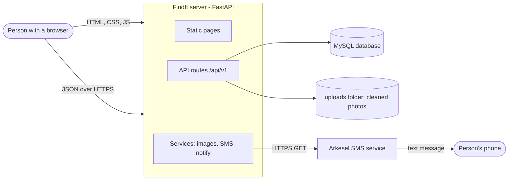
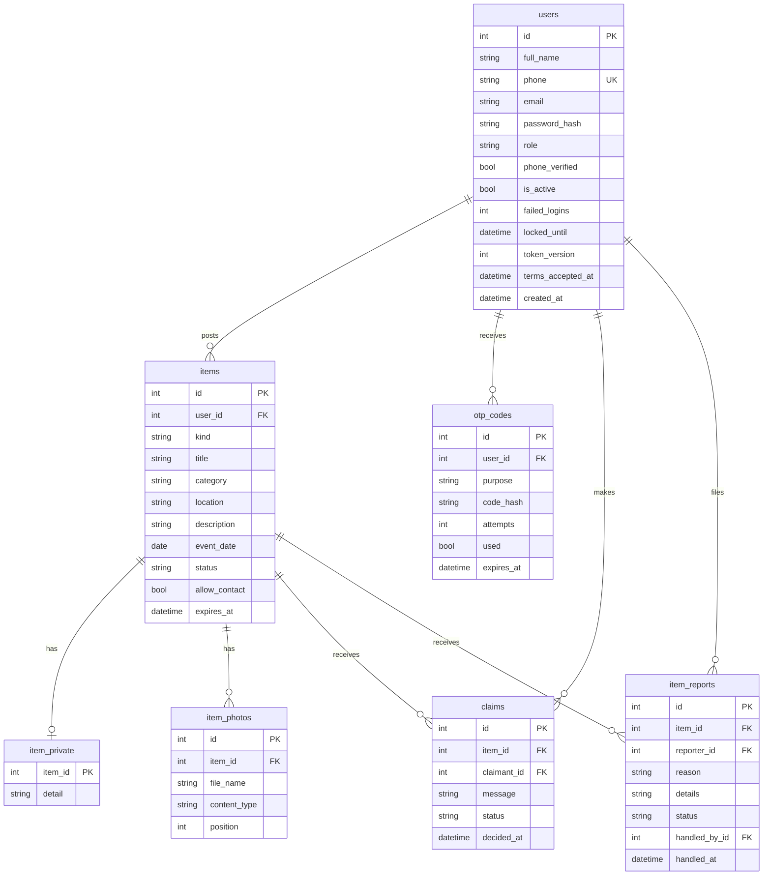

# Design Document: FindIt

This document explains how FindIt is built and why. It goes with the [SRS](SRS.md) (what the system must do), the [UML diagrams](UML.md) (flows and data), and the [test plan](TEST_PLAN.md).

## 1. Overview

FindIt lets people at USTED report lost and found items, search for them, and claim them. Phone numbers are the identity: every account is checked by an SMS code, and SMS is also used for the messages people need (claims, decisions, moderation, password reset).

**Design goals**

1. Safe by default: a stranger must not learn a phone number, a private detail or where a photo was taken.
2. Simple to run: one Python service, one database, plain web pages. No build step.
3. Easy for a team to extend: one new file adds one new feature.

## 2. Architecture



- The server sends the web pages itself (`frontend/`) and answers JSON requests under `/api/v1`.
- The pages are plain HTML, CSS and JavaScript. They call the API with `fetch`.
- The database holds people, items, claims and reports. Photos are saved as files in `uploads/`, and the database stores only their names.
- Texts are sent in the background after the answer is returned, so a slow SMS service never slows a page down.

## 3. Technology choices

| Part | Choice | Why |
| --- | --- | --- |
| Web framework | FastAPI | Short, readable routes; automatic checking of requests; easy to test. |
| Database | MySQL 8 | Reliable, familiar to the team, free. |
| Database access | SQLAlchemy 2 | Models are Python classes; protects against SQL injection. |
| Migrations | Alembic | Every change to the tables is saved in Git and can be replayed. |
| Passwords | Argon2id | Modern password hashing, slow for attackers. |
| Sessions | JWT in an httpOnly cookie | The page's JavaScript cannot read the cookie. |
| SMS | Arkesel | Works with Ghana networks; satisfies the brief's "external service". |
| Photos | Pillow | Re-saves each photo without hidden camera and location data. |
| Tests | pytest | Runs in seconds with an in-memory database. |
| Pages | Plain HTML, CSS, JS | No build step; every teammate can read it. |

## 4. Code layout

```
app/
  main.py            starts the app and mounts every router automatically
  core/              settings, database, security, permissions, rate limiter
  models/            database tables (one file per area)
  schemas/           what each request and response looks like
  routers/           API routes (one file per feature)
  services/          SMS, notifications, photo cleaning
  scripts/           make_admin command
frontend/            pages, styles, scripts, images
migrations/          Alembic history
tests/               pytest files
docs/                SRS, UML, design, test plan, risks, sprints, demo
```

A new feature is a new file in `app/routers/` that defines `router`. `main.py` finds it, so it never has to be edited.

## 5. Database design



Design notes:

- **Phone is unique.** It is stored in `233XXXXXXXXX` form whatever way the person typed it.
- **Private detail has its own table** (`item_private`). A mistake in a public query cannot leak it, because it is never part of the public item row.
- **Codes are stored hashed** (keyed HMAC), never as typed.
- **Indexes** are on the columns people search and filter by: item kind, category, location, status and owner; claim item, claimant and status; report item, reporter and status.
- **Statuses** are plain strings: an item is `open`, `claim_pending`, `returned`, `closed` or `removed` (see the state diagram in the UML file). "Expired" is worked out from `expires_at`, not stored.

## 6. API design

All routes are under `/api/v1`, take and return JSON, and report problems as `{"detail": "..."}` with a normal status code (400, 401, 403, 404, 409, 422, 429).

| Method | Path | Who can use it |
| --- | --- | --- |
| POST | /auth/register | Public |
| POST | /auth/verify-phone | Public |
| POST | /auth/resend-code | Public |
| POST | /auth/login | Public |
| POST | /auth/logout | Public |
| GET | /auth/me | Logged-in member |
| POST | /auth/forgot-password | Public |
| POST | /auth/reset-password | Public |
| GET | /items | Public |
| POST | /items | Logged-in member |
| GET | /items/mine | Logged-in member |
| GET | /items/{id} | Public (the owner also sees the private detail) |
| POST | /items/{id}/photos | Logged-in member (owner) |
| GET | /items/{id}/photos/{photo_id} | Public |
| POST | /items/{id}/close | Logged-in member (owner) |
| POST | /items/{id}/returned | Logged-in member (owner) |
| POST | /items/{id}/claims | Logged-in member |
| POST | /items/{id}/report | Logged-in member |
| GET | /claims/mine | Logged-in member |
| GET | /claims/received | Logged-in member |
| POST | /claims/{id}/approve | Logged-in member (item owner) |
| POST | /claims/{id}/decline | Logged-in member (item owner) |
| POST | /claims/{id}/withdraw | Logged-in member (claimant) |
| GET | /profile | Logged-in member |
| PUT | /profile | Logged-in member |
| POST | /profile/password | Logged-in member |
| GET | /admin/reports | Moderator or admin |
| POST | /admin/reports/{id}/remove | Moderator or admin |
| POST | /admin/reports/{id}/dismiss | Moderator or admin |
| POST | /admin/items/{id}/restore | Moderator or admin |
| GET | /admin/stats | Admin |
| GET | /admin/users | Admin |
| POST | /admin/users/{id}/suspend | Admin |
| POST | /admin/users/{id}/restore | Admin |
| GET | /health | Public |

"Owner" rules (for example, only the item's owner can approve a claim) are checked inside the route. FastAPI also shows every route and its fields at `/docs` while the server is running.

## 7. Main flows

The sequence diagrams for claiming an item and resetting a password, and the state diagram for item status, are in [UML.md](UML.md).

## 8. Security design

| Threat | What the design does |
| --- | --- |
| Stolen database | Passwords use Argon2id; SMS codes are stored as keyed hashes. |
| Guessing a password | After 5 wrong tries the account locks for 15 minutes. |
| Guessing an SMS code | A code allows 5 tries, lasts 10 minutes, and can be used once. A new code can be asked for only after 60 seconds. |
| Learning who has an account | Forgot-password gives the same answer for every number. |
| Spamming the server or SMS | A per-address rate limit on sign-up, codes, login, posting and photo upload. |
| Stolen session | The cookie is httpOnly and lasts 30 minutes. A password change or a suspension raises `token_version`, which signs out every older session at once. |
| Leaking a location | Photos are re-saved with the camera and GPS data removed. |
| Leaking private details | The private detail is a separate table and goes only to the item's owner. |
| Leaking phone numbers | A number is shared only after a claim is approved, and the owner's only if they allowed contact. |
| Staff misuse | Three roles (member, moderator, admin) are checked on the server. Hiding a button is only for neatness. |
| Leaked secrets | Keys and passwords live in `.env`, which is not in Git. The SMS key is in the request address, so the request is never logged. |

## 9. SMS integration

- **Provider:** Arkesel's classic `sms/api` request.
- **Sending:** codes are sent straight away; all other messages go through `notify()` in the background. If the SMS provider is down, `notify()` logs the error class and the action still succeeds.
- **Reading the reply:** Arkesel answers `200 OK` even for a message it will not deliver, so the app also reads the reply. It logs a warning when the code is not `ok` or when the balance drops under 20 credits. It never logs the address or key.
- **What cannot be detected from the reply:** a sender name that Arkesel has not approved. Messages then wait at `SUBMITTING` in the Arkesel dashboard. We met this at the start of testing, and the cure was getting "FindIt" approved.

## 10. Web pages

| Page | Purpose | Who |
| --- | --- | --- |
| index, login, register, verify, forgot | Entry and account recovery | Public |
| terms | Terms and Privacy Policy | Public |
| dashboard | Home: greeting, search, recent items, menu | Members |
| browse, item | Search and view items; claim or report | Public (acting needs login) |
| report | Post a lost or found item with photos | Members |
| myposts | Own posts, waiting claims, close, mark returned | Members |
| claims | Claims made and received | Members |
| profile | Name, email, password | Members |
| admin | Moderation queue | Moderators, admins |
| users | Admin overview: totals, people, suspend and restore | Admins |

All pages share `style.css` and the helper functions in `common.js`. Pages are laid out to work on a phone screen, with a 16 px side margin.

## 11. Design decisions and trade-offs

| Decision | Reason | Cost |
| --- | --- | --- |
| Phone number as identity | Almost every student has a phone; SMS is how people in Ghana expect to verify. | An SMS credit per code; people who change numbers need help. |
| `token_version` for sign-out | Works to the exact moment, unlike comparing timestamps to the second. | One more column. |
| Rate limits kept in memory | No extra service to run. | They reset on restart and are not shared if the app runs on several servers. |
| Background tasks for SMS | Pages stay fast. | A text lost on a crash is not retried. |
| Plain HTML pages | Nothing to build or learn. | More repeated markup than with a framework. |
| Routers found automatically | A feature is one file. | Every file in `routers/` must define `router`. |

## 12. Known limitations and future work

- Accounts cannot be deleted from the site; the Terms say requests are handled by hand.
- A phone number cannot be changed (it would need a new SMS check).
- No email sending, so no password reset by email.
- No Google sign-in (the button is shown as "coming soon").
- Suspending someone does not hide their existing posts; moderators remove them through reports.
- The rate limiter and the SMS retries would need a shared store (for example Redis) before running on several servers.
- Terms text and the contact email need review by the team before launch.
