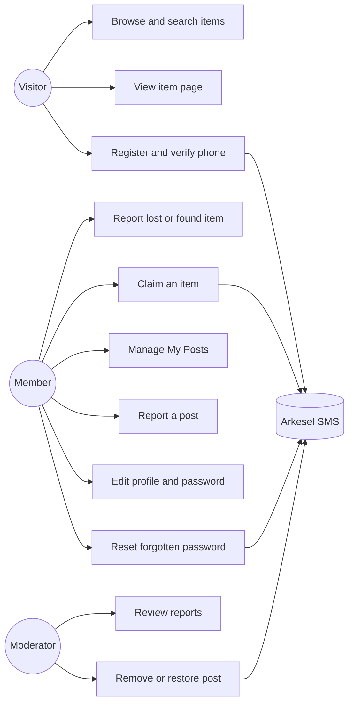
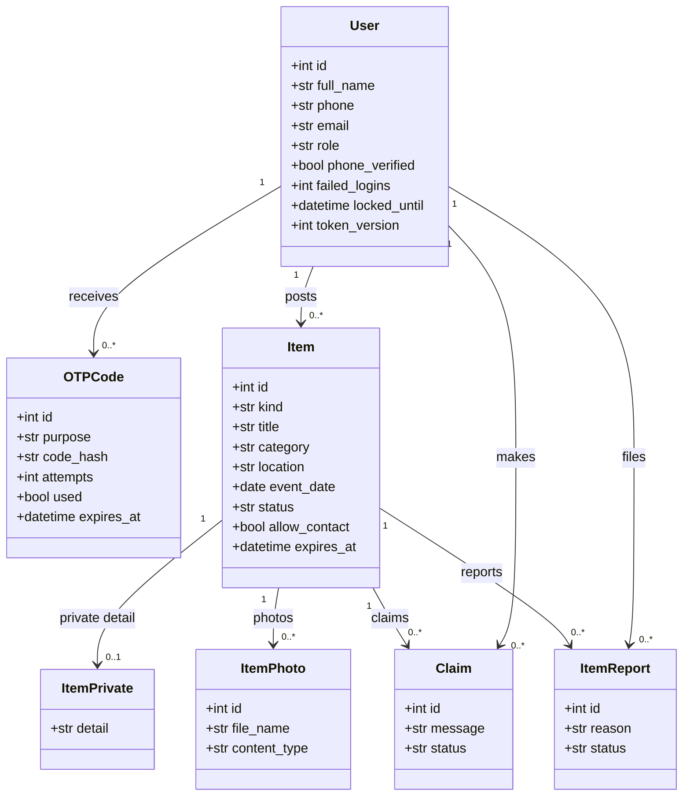
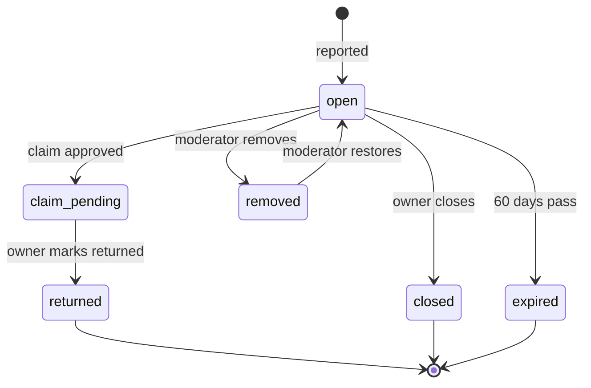
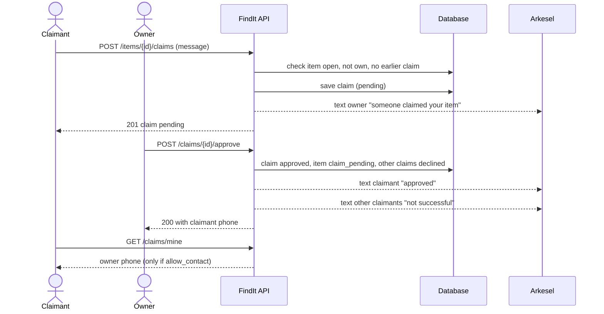
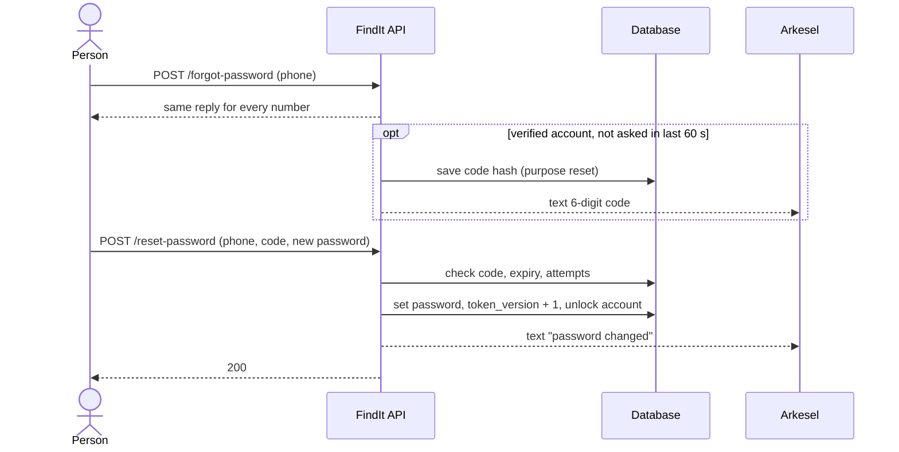

# UML diagrams: FindIt

The diagrams use Mermaid, which GitHub draws automatically when this file is viewed.

## 1. Use case diagram

## 2. Class diagram (data model)

## 3. State diagram (item status)

## 4. Sequence diagram: claim and approval

## 5. Sequence diagram: password reset

